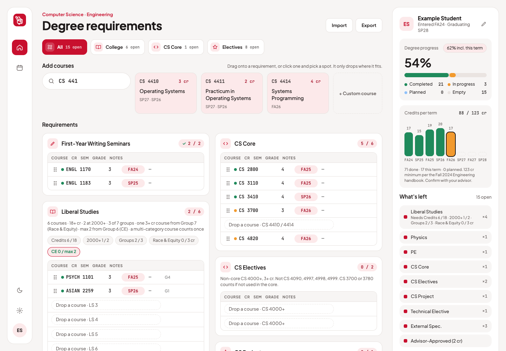

# BearPlan

[](https://github.com/jaredrojas08/bearplan/actions/workflows/ci.yml)
[](LICENSE)

A degree-progress planner for Cornell students. Drag courses onto your major's checklist and see what's done, what's in progress and what's left before you graduate.



- **Checklist view** modeled on the paper CS checklist: every requirement section as a table of Course, Cr, Sem, Grade and Notes.
- **Rules that refuse bad drops.** A course only drops where it fits. Rows it can't go in say why ("Needs CS 4000+", "No PE courses", "OPHLS-AG, PHS-AS, SCT-IL are not Liberal Studies categories").
- **Status from the calendar.** Past terms count as completed, the current term as in progress, later terms as planned. Nothing to keep up to date by hand.
- **Progress panel**: percent of requirements done, credits per term against the degree total, what's left and plan-wide checks (probability, Engineering Communications).
- **Semester view**: one column per term. Drag a course to another term to reschedule it.
- **Course search** over every course in recent Class Roster terms, plus custom courses for AP and transfer credit.
- **Any major.** Requirements are JSON templates, so adding a major is adding a file.
- **Private by default.** Your plan lives in your browser's local storage. Export and import it as JSON.

> BearPlan is a student project and is not affiliated with Cornell University. Requirement data is transcribed from public handbooks and can be wrong or out of date. Always confirm your plan with your advisor.

## Getting started

Needs [Node.js](https://nodejs.org/) 20.19 or newer.

```sh
git clone https://github.com/jaredrojas08/bearplan.git
cd bearplan
npm install
npm run dev
```

Open the URL Vite prints (usually http://localhost:5173). On first run you'll set up a plan: your name, a checklist, and your entry and graduation terms. Choose **Try the example plan** to explore with sample data.

| Command | What it does |
|---|---|
| `npm run dev` | Dev server with hot reload |
| `npm test` | Unit tests (Vitest) |
| `npm run check` | Type-check Svelte and TypeScript |
| `npm run build` | Production build into `dist/` |
| `npm run fetch-courses` | Refresh the course catalog (below) |

## Refreshing course data

Search runs over `public/courses.json`, a cached copy of the [Cornell Class Roster API](https://classes.cornell.edu/api/2.0/). It is checked in, so the app works offline. To refresh it:

```sh
npm run fetch-courses                              # newest two fall/spring rosters
npm run fetch-courses -- --rosters SP27,FA26,SP26  # specific rosters
npm run fetch-courses -- --subjects CS,MATH        # quick partial run
```

The script requests every subject in each roster, one request per second as the API asks, so a full roster takes about three minutes. Courses are deduped by code; the newest roster's title and credits win. Each entry looks like:

```json
{ "code": "ASTRO 1101", "title": "From New Worlds to Black Holes", "creditsMin": 3, "creditsMax": 3,
  "distributions": ["OPHLS-AG", "PHS-AS", "SCT-IL"], "rosters": ["FA26"] }
```

## Adding a major

Write a requirement template and import it from the app's settings, or add it to `src/templates/` and open a pull request. The full format, with examples, is in **[docs/templates.md](docs/templates.md)**.

## How it works

```text
src/
  types.ts               Template, Plan and catalog types
  templates/*.json       Requirement templates (one per major)
  seed/example-plan.json Sample plan for "Try the example plan"
  lib/requirements.ts    Rule checks, drop refusals, progress, what's left (pure functions)
  lib/terms.ts           Term math and status from today's date
  lib/validate.ts        Shape checks for imported plans and templates
  lib/search.ts          Fuzzy course search
  lib/store.svelte.ts    App state, local storage, import and export
  components/            Svelte components
scripts/fetch-courses.mjs  Class Roster API to public/courses.json
```

The requirement logic is plain TypeScript with no UI dependencies, and the tests in `src/lib/*.test.ts` cover it, including a full check of the example plan's "What's left" list.

A saved plan looks like:

```json
{
  "version": 1, "name": "Example Student", "templateId": "cs-engineering-fa24",
  "entryTerm": "FA24", "gradTerm": "SP28", "swimTest": false, "spclArea": "",
  "courses": [
    { "uid": "seed-01", "code": "ENGL 1170", "title": "FWS: Short Stories", "credits": 3,
      "term": "FA24", "grade": "B", "placement": "fws/fws1" }
  ]
}
```

`placement` is `sectionId/slotId` for fixed rows, `sectionId` for credit buckets, or `additional`.

## Contributing

Bug reports, fixes and new major templates are welcome. See [CONTRIBUTING.md](CONTRIBUTING.md).

## License

[MIT](LICENSE)
